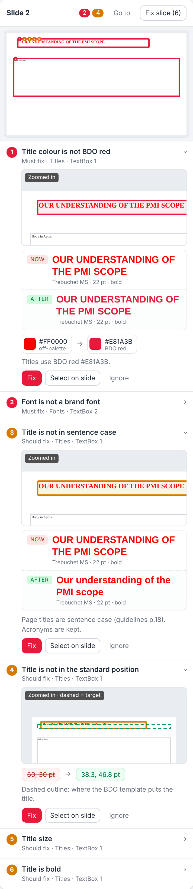

# Client-Ready: BDO formatting add-in for PowerPoint

A pane on the right of PowerPoint that reviews the whole deck against the BDO 2023 brand:
- **Score and summary**: client-ready score, issues by category, and one button to fix every safe issue.
- **One card per slide**: a preview of the slide with each problem box outlined and numbered.
- **Every recommendation zoomed in**: the exact box magnified, the words shown as they are **now** and **after** the fix (font, size, colour, bold, case), colour swatches, highlighted text changes (double spaces, ₹ … Cr / lakh), and a dashed outline where a title should sit.
- **Per issue**: Fix, Select on slide, or Ignore. **Fix slide**, **Apply all** for one issue type, and **Fix all safe issues** for the deck.
- **Filters** by category (titles, fonts, colours, text, layout, clean-up, draft text), severity (must / should / check), by slide or by type.
- **Tools**: body text size, change fonts, remove empty boxes (with confirm). **Rules**: the BDO palette, fonts and sizes in use.

 

Rules: `docs/BRAND_RULES.md`. Why these features: `docs/STUDY_FINDINGS.md` (27 real proposals measured).

Every action shows what changed and what was skipped, and can be undone with **Ctrl+Z**.

> The brand rules are drafted from the BDO 2023 guidelines and template and are **awaiting approval** (see `docs/BRAND_RULES.md`). Try it on copies of decks first.

## Install (try in this order)
1. **PowerPoint on the web** (easiest for testing): open a deck → **Home → Add-ins → More Add-ins → My Add-ins → Upload My Add-in** → choose `manifest.xml`.
2. **PowerPoint desktop**: the same route (older versions: **Insert → Get Add-ins**). If "Upload My Add-in" is missing or greyed out, the firm's policy has turned it off. Don't work around it; use route 3.
3. **Developer add-in (double-click):** run `install/Install Client-Ready.cmd`, close and reopen PowerPoint, and Client-Ready appears under **Home → Add-ins → Developer add-ins**. It registers the add-in for your Windows user only (no admin rights, nothing downloaded). `install/Uninstall Client-Ready.cmd` removes it. On a company laptop, check this is acceptable under your IT policy.
4. **IT central deployment**: give IT `docs/IT_NOTE.md` and `manifest.xml`. They upload it in the Microsoft 365 admin centre, and it appears for you automatically.

The add-in loads from `https://kushalwork7111-svg.github.io/JOB-Helper/`. GitHub Pages must be turned on for this repo (Settings → Pages → Deploy from branch `main`, folder `/ (root)`). On a free GitHub plan, Pages needs the repository to be public. That's fine, because nothing confidential is stored here.

**Why not Google Apps Script?** Apps Script web apps are served inside Google's sandboxed iframes. Office add-ins must run their own page directly, and inside those frames Office.js cannot connect to PowerPoint, so the pane would stay blank. Use GitHub Pages or Firebase Hosting (both free, static HTTPS).

## For developers
- `node tests/run.js`: unit tests for `src/rules.js`.
- `python3 tests/make_test_deck.py`: rebuilds the synthetic messy deck `tests/decks/messy.pptx`.
- Rules for working on this repo: `CLAUDE.md`.
