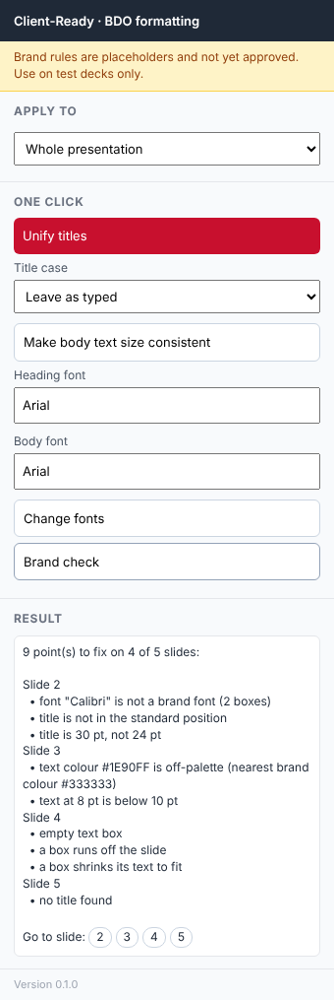

# Client-Ready: BDO formatting add-in for PowerPoint

A pane on the right of PowerPoint with one-click buttons:
- **Unify titles**: every title in the same position, size, font, colour and (optionally) case.
- **Make body text size consistent**: one body size and font. Footers and source lines are left alone.
- **Change fonts**: headings and body separately, for the whole deck or selected slides.
- **Brand check**: lists what breaks the rules, slide by slide, with "go to slide" buttons.

Every action shows what changed and what was skipped, and can be undone with **Ctrl+Z**.

> The brand rules are **placeholders** until the BDO guidelines are studied and approved (see `docs/BRAND_RULES.md`). Use it on test decks only until then.

## Install (try in this order)
1. **PowerPoint on the web** (easiest for testing): open a deck → **Home → Add-ins → More Add-ins → My Add-ins → Upload My Add-in** → choose `manifest.xml`.
2. **PowerPoint desktop**: the same route (older versions: **Insert → Get Add-ins**). If "Upload My Add-in" is missing or greyed out, the firm's policy has turned it off. Don't work around it; use route 3.
3. **IT central deployment**: give IT `docs/IT_NOTE.md` and `manifest.xml`. They upload it in the Microsoft 365 admin centre, and it appears for you automatically.

The add-in loads from `https://kushalwork7111-svg.github.io/JOB-Helper/`. GitHub Pages must be turned on for this repo (Settings → Pages → Deploy from branch `main`, folder `/ (root)`). On a free GitHub plan, Pages needs the repository to be public. That's fine, because nothing confidential is stored here.

## For developers
- `node tests/run.js`: unit tests for `src/rules.js`.
- `python3 tests/make_test_deck.py`: rebuilds the synthetic messy deck `tests/decks/messy.pptx`.
- Rules for working on this repo: `CLAUDE.md`.
